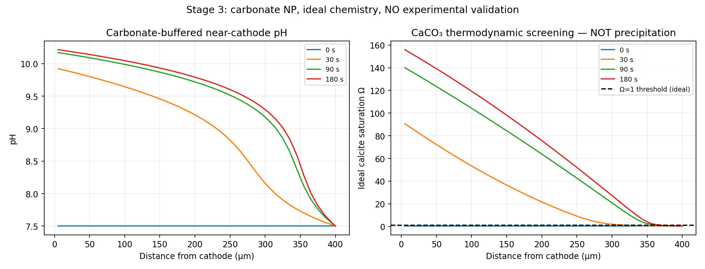

# Local pH Gradients at Electrified Interfaces

*A reproducible Python and PHREEQC study of ion transport, carbonate chemistry, and calcite supersaturation.*

[Research story](docs/PROJECT_STORY.md) · [Methods](docs/METHODS.md) · [Results](docs/RESULTS.md) · [How to reproduce](docs/REPRODUCIBILITY.md) · [Limitations and next steps](docs/SCIENTIFIC_SCOPE_AND_NOVELTY.md)



## Why this project?

Electricity can change the chemistry of a solution right next to an electrode—even when the bulk liquid barely changes. That opens up interesting possibilities for controlling local pH without continually adding acid or base. But it also raises a practical question: could the same local pH shift encourage mineral scaling?

I used this question as the starting point for an **independent, exploratory computational portfolio**. The aim was not to build a complete electrochemical device model. It was to understand one part of the problem at a time, check the numerical calculations, and identify where the simple chemistry stops being reliable.

**Central question:** How do diffusion, electric-field-driven migration, carbonate buffering, and aqueous complexation affect estimates of calcite supersaturation close to an idealized cathode?

> **Please read before interpreting the figures:** Everything shown here is a calculation, not a measured pH profile or a demonstration of actual mineral deposition. The models are simplified and have **not** been validated against matched local-pH experiments. This project is not affiliated with, supervised by, or endorsed by Wageningen University or the authors of the cited papers.

## What I explored

The work developed in six steps, each motivated by a limitation in the previous one.

| Step | The question I worked on | Implementation |
|---|---|---|
| **1 — Local pH** | How does an imposed cathodic OH-equivalent flux affect pH over time? | 1-D finite-volume diffusion model, buffering approximation, analytic and grid checks |
| **2 — Ion migration** | What changes when charged species also move in an electric field? | Simplified electroneutral Nernst–Planck transport for Na⁺, Cl⁻, H⁺ and OH⁻ |
| **3 — Carbonate and calcium** | When does higher pH suggest a greater thermodynamic tendency toward calcite scaling? | Ideal carbonate equilibrium, calcium-containing electrolyte, illustrative Ω indicator |
| **4 — Literature check** | Are the modeled quantities comparable with published membrane/desalination measurements? | An audit of device conditions and observables; no inappropriate outlet-to-local pH comparison |
| **5 — PHREEQC benchmark** | Does an ideal-concentration saturation calculation survive more complete aqueous speciation? | Davies approximation plus PHREEQC runs at fixed pH and adjusted pH for charge balance |
| **6 — Spatial speciation** | How do free calcium and saturation estimates vary across the boundary layer? | 40 cell centers × 4 applied-current scenarios = 160 one-way PHREEQC equilibrium calculations |

These are **separate modeling and diagnostic steps**, not a fully coupled or experimentally verified reactive-transport model.

## The result that changed my interpretation

At 180 seconds, one illustrative Stage 3 calculation with **0.5 A/m²** imposed current density yielded a **first-cell pH of 10.215** and an idealized calcite saturation ratio of **Ω = 155.92**. It would be tempting to stop there and call this severe scaling.

However, when the same dissolved component totals were passed to PHREEQC **at the same imposed pH**, the calculated calcite saturation ratio was **Ω = 39.99**. With pH instead adjusted to satisfy charge balance, PHREEQC gave **pH = 10.013** and **Ω = 34.62**.

| Model or calculation | pH | Calcite Ω |
|---|---:|---:|
| Simplified ideal-concentration calculation | 10.215 | 155.92 |
| PHREEQC, pH held fixed | 10.215 | **39.99** |
| PHREEQC, pH adjusted for charge balance | 10.013 | **34.62** |

This is **not a measured prediction error**: the calculations use different chemistry assumptions, and the third row also uses a different pH. It shows why activities and aqueous complexes cannot be ignored when interpreting carbonate saturation.

Another useful finding was the distinction between dissolved calcium species and solid scale. For this fixed-pH PHREEQC case, approximately **0.222 mmol/kg water** was assigned to the **dissolved CaCO₃(aq) complex**. That is not 0.222 mmol of precipitated calcite.

Read [the full numerical results and their provenance](docs/RESULTS.md).


## What worked, and what still needs work

- **33 code-level numerical and consistency tests pass** in this repository. These test calculations and implementation behavior, not experimental accuracy.
- The researcher ran **PHREEQC 3.8.6 locally on Ubuntu** for the five-point reference comparison and 160 spatial samples. A compact transcription of the **five-point** output is provided under [`data/benchmarks/`](data/benchmarks/); full 160-row raw outputs need to be regenerated locally.
- Re-speciating Stage 3 results with PHREEQC exposed **charge-balance and alkalinity mismatches**. I treat those mismatches as findings to investigate, not quantities to hide or tune away.
- The current workflow **does not** predict precipitation rates, deposited mass, membrane behavior, gas-bubble mixing, or time-dependent feedback from PHREEQC into ion transport.

The strongest contribution here is a **traceable learning and verification workflow**: code, tests, thermodynamic cross-checks, and an explicit account of where the assumptions break down. I do **not** claim a newly discovered physical mechanism or a method proven novel against all prior research.

## Run it yourself

Requirements: **Python 3.11+** and the dependencies in `requirements.txt`. To run equilibrium checks, separately install **USGS PHREEQC v3** and locate its `phreeqc.dat` database.

```bash
python3 -m venv .venv
source .venv/bin/activate
python -m pip install -r requirements.txt
python -m unittest discover -s tests -v
python run.py
python run_stage2.py
python run_stage3.py
```

For the actual PHREEQC benchmarks:

```bash
export PATH="$HOME/.local/bin:$PATH"  # only if PHREEQC lives here
DB="$HOME/.local/share/doc/phreeqc/database/phreeqc.dat"  # adjust to your installation
bash run_phreeqc.sh "$DB"
bash run_stage6.sh "$DB"
cat results_stage6/stage6_summary.json
```

If your executable or database is elsewhere, consult the [step-by-step reproduction guide](docs/REPRODUCIBILITY.md). Figures under `figures/` are illustrations from model runs; generated `results*/` directories are intentionally Git-ignored.

## Where to look

| File | Purpose |
|---|---|
| [`docs/PROJECT_STORY.md`](docs/PROJECT_STORY.md) | Plain-English account of the research process and why each step was added |
| [`docs/METHODS.md`](docs/METHODS.md) | Equations, numerical assumptions, and model interfaces |
| [`docs/RESULTS.md`](docs/RESULTS.md) | Numerical findings with provenance and correct interpretation |
| [`docs/SCIENTIFIC_SCOPE_AND_NOVELTY.md`](docs/SCIENTIFIC_SCOPE_AND_NOVELTY.md) | Contribution, open problems, and claims this code cannot support |
| [`docs/REPRODUCIBILITY.md`](docs/REPRODUCIBILITY.md) | Complete Linux instructions and PHREEQC setup |
| [`docs/APPLICATION_BLURB.md`](docs/APPLICATION_BLURB.md) | Careful wording for a CV or research application |
| [`PUBLISHING_GUIDE.md`](PUBLISHING_GUIDE.md) | Steps to publish your own fork/copy on GitHub |

## References and credit

The project was informed by work on pH shifts and mineral scaling in electrochemical desalination, including:

- Arulrajan et al. (2021), [*Unravelling pH Changes in Electrochemical Desalination with Capacitive Deionization*](https://doi.org/10.1021/acs.est.1c04479).
- Arulrajan et al. (2024), [*Mitigation of mineral scaling in membrane capacitive deionization*](https://doi.org/10.1016/j.jwpe.2024.105094).
- Parkhurst and Appelo, [USGS PHREEQC v3](https://www.usgs.gov/software/phreeqc-version-3/).

The cited researchers did not contribute to this repository. Please cite their original work separately. The repository does not include third-party journal figures or proprietary PHREEQC databases. See [the license note](LICENSE_DECISION.md) before reusing the code.
