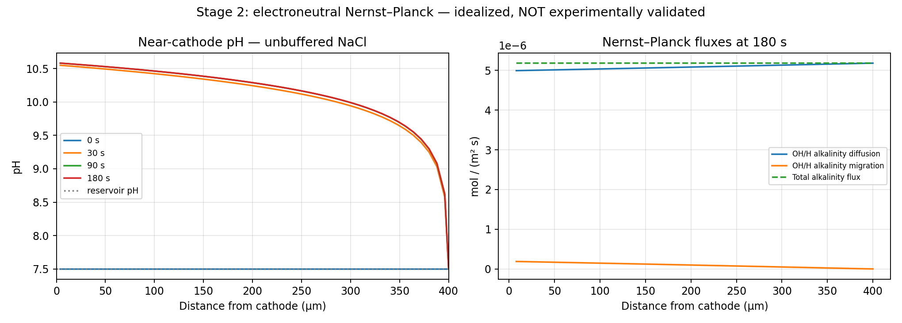

# Results: the numbers, where they came from, and what they mean

All results here are **computational examples**. No new laboratory measurements were performed. The five-point PHREEQC values were transcribed from terminal output supplied after a local Ubuntu PHREEQC 3.8.6 run with `phreeqc.dat`. The packaged Python tests were run separately. The external PHREEQC executable was not rerun in the packaging environment.

## 1. Numerical checks before chemical interpretation

For the Stage 1 analytical diffusion benchmark at 180 s:

- Reference wall pH: **9.629835782**.
- Discretized wall pH at 80 cells: **9.629834844**.
- Absolute difference: approximately **9.39 × 10⁻⁷ pH units**.
- Reported relative mass-balance residual: **1.60 × 10⁻⁶**.
- Wall pH error fell from about **1.40 × 10⁻⁵** at 20 cells to **2.85 × 10⁻⁷** at 160 cells.

These are useful **numerical verification** results for a simple diffusion problem. They do not establish the accuracy of an electrochemical pH prediction in a laboratory cell.

## 2. What the Nernst–Planck example showed

In a simplified unbuffered NaCl solution (5 mmol/L, 0.5 A/m², bulk pH 7.5, 400 μm domain, 180 s), the calculation reported:

- pH at the **first cell center**: **10.5825**.
- pH at the **last cell center**: **8.6229**.
- Bulk-reservoir pH at the exact right boundary: **7.5**.

The distinction between the last cell center and the mathematical boundary matters. These values are outputs of the model, not measurements.

## 3. Carbonate model: a strong warning from an ideal approximation

Default Stage 3 settings include an initial bulk pH of 7.5, 0.5 mmol/L calcium, 2 mmol/L dissolved inorganic carbon and 10 mmol/L chloride. At 180 s, the **first computational cell** showed:

| Applied current density (A/m²) | Calculated pH | Idealized calcite Ω |
|---:|---:|---:|
| 0.00 | 7.500 | 0.418 |
| 0.15 | 9.432 | 36.688 |
| 0.50 | 10.215 | 155.923 |
| 1.00 | 10.642 | 258.402 |

These large Ω values are **screening estimates based on ideal chemistry**. Nothing in this stage predicts precipitation rates or the amount of solid scale.

## 4. PHREEQC changed the interpretation

At **0.5 A/m²**, these calculations were compared:

| Chemistry treatment | pH | Calcite Ω | Calcite SI |
|---|---:|---:|---:|
| Stage 3 ideal concentrations | 10.2151 | 155.92 | — |
| Approximate Davies, adjusted pH | 10.0823 | 61.69 | — |
| PHREEQC with **fixed Stage 3 pH** | 10.2151 | **39.99** | **1.6020** |
| PHREEQC with pH adjusted for **charge balance** | 10.0133 | **34.62** | **1.5393** |

At the **same imposed pH**, the PHREEQC saturation ratio is about **74.4% below** the ideal-concentration indicator. That percentage is **not an experimental prediction error**. It describes the effect of a different chemical/speciation model for the supplied component totals.

Why does calcium speciation matter? The fixed-pH PHREEQC output reported:

| Calcium quantity | mmol/kg water | Interpretation |
|---|---:|---|
| Total dissolved Ca input | 0.55636 | All dissolved calcium species combined |
| Free Ca²⁺ | 0.33320 | Approximately 59.9% of total |
| Dissolved CaCO₃(aq) | 0.2218 | Approximately 39.9% of total, **not precipitated calcite** |
| Free CO₃²⁻ | 0.98762 | Dissolved carbonate ion |

PHREEQC uses activities of **free ions** in the calcite ion-activity product. The simple use of total dissolved calcium can obscure how much calcium is tied up in aqueous complexes. Minor complexes account for the small remainder.

[Downloadable compact benchmark values](../data/benchmarks/stage5_reported_phreeqc.csv) retain the origin and calculation protocol of each number.

## 5. The spatial comparison revealed an unresolved mismatch

The Stage 6 workflow prepared **160 input solutions** (40 positions × four current scenarios). PHREEQC was run on the researcher's Ubuntu installation, and the resulting diagrams were shared for review. The full 160-row selected-output files and JSON summary were **not provided for inclusion in this repository**. Re-run `run_stage6.sh` to generate them for independent inspection.

The images indicate the modeled boundary layer has higher cathode-adjacent saturation tendency and a greater proportion of dissolved CaCO₃(aq) near higher pH. However, the one-way PHREEQC re-speciation also exposes **nonzero charge-balance and alkalinity differences** relative to Stage 3.

This is an important limitation—not a solved result. Stage 3 and PHREEQC do not yet share a fully consistent activity, speciation and alkalinity framework.

## 6. What we can and cannot conclude

**Supported by these computations:** the code can reproduce its numerical controls; the ideal concentration-based indicator is sensitive to more complete thermodynamic treatment; soluble complexation affects the free calcium inventory; and the one-way coupling has identifiable compatibility problems.

**Not supported yet:** measured near-electrode pH accuracy; mineral precipitation rates or mass; a membrane-cell prediction; or performance under hydrodynamic mixing and gas evolution.

The next credible milestone is a physically and thermodynamically consistent reactive-transport formulation followed by validation with a *matched* local-pH dataset.
